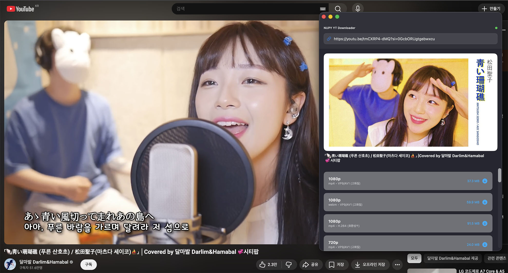

# YT Downloader

유튜브 영상/오디오를 다운로드할 수 있도록 해준다.



Rust + Tauri 2로 다시 만든 버전이다. 다운로드 로직은 Rust로 한 번만 작성하고, 화면은 macOS와 Windows를 각자의 디자인에 맞춰 따로 만든다.

| | macOS | Windows |
|---|---|---|
| 지원 | Apple Silicon(arm64), macOS 13+ (Intel Mac 미지원) | Windows 10/11, x64 · arm64 |
| 화면 | `ui/macos` — vibrancy 배경, 오버레이 타이틀바, 인셋 그룹 목록, 시트 | `ui/windows` — Mica 배경, Fluent 2(WinUI 3) 컨트롤, Segoe Fluent Icons, ContentDialog |
| 저장 대화상자 | NSSavePanel (tauri-plugin-dialog) | IFileSaveDialog (tauri-plugin-dialog) |

## yt-dlp 자동 업데이트

yt-dlp와 ffmpeg는 앱에 넣지 않고 실행 중에 내려받는다. YouTube 쪽 변경으로 yt-dlp가 새로 나와도 **앱을 다시 빌드하지 않아도 된다.**

1. 처음 실행하면 yt-dlp와 ffmpeg를 사용자 데이터 폴더에 내려받는다.
   - macOS: `~/Library/Application Support/NKStudio/YTDownloader/bin`
   - Windows: `%APPDATA%\NKStudio\YTDownloader\bin`
   - 기존 Swift / WinUI 버전과 같은 위치라서 이미 받아 둔 파일을 이어 쓴다.
2. 실행할 때마다 GitHub의 yt-dlp 최신 릴리스를 확인하고, 더 새 버전이 있으면 바로 교체한다. 실패하면 기존 버전으로 계속 쓰고 업데이트 버튼을 보여준다.
3. 내려받은 파일은 릴리스의 `SHA2-256SUMS`(ffmpeg는 배포처의 sha256)로 검증한 뒤에 교체한다.
4. 다운로드 중에는 교체하지 않는다 (Windows는 실행 중인 exe를 덮어쓸 수 없다).

| | yt-dlp | ffmpeg |
|---|---|---|
| macOS | `yt-dlp_macos.zip` (onedir, 실행이 빠름) | [martin-riedl.de](https://ffmpeg.martin-riedl.de) arm64 정적 빌드 |
| Windows | `yt-dlp.exe` / `yt-dlp_arm64.exe` | [BtbN/FFmpeg-Builds](https://github.com/BtbN/FFmpeg-Builds) `win64` / `winarm64` |

## 기능

- 링크를 붙여넣으면 바로 영상 정보와 형식 목록을 가져온다.
- 영상: 영상 전용 형식은 가장 좋은 오디오(m4a 우선)와 합쳐 mp4로 저장한다.
- 오디오: **변환하지 않고 원본 형식(m4a/webm) 그대로 저장한다.** (Windows 버전에 있던 MP3 변환은 없앴다)
- 진행률(영상 → 오디오 2단계 합산), 속도, 남은 시간 표시와 취소. 취소하면 중간 파일을 지운다.
- 완료 후 Finder / 탐색기에서 파일 위치 열기.

## 구조

```
crates/nupy-core/   UI와 무관한 Rust 코어
  src/platform.rs   플랫폼별 바이너리 이름과 배포처
  src/tools.rs      yt-dlp / ffmpeg 설치, 버전 확인, 체크섬 검증, 교체
  src/ytdlp.rs      영상 정보 조회, 다운로드, 진행률 파싱, 취소
src-tauri/          Tauri 2 셸 (명령, 상태, 창 설정)
  tauri.conf.json           공통 설정
  tauri.macos.conf.json     macOS 창(vibrancy, 오버레이 타이틀바) · 번들(app, dmg)
  tauri.windows.conf.json   Windows 창(Mica) · 번들(NSIS, MSI)
ui/shared/          공통 상태(model.ts), Rust 명령 호출(backend.ts), 표시용 도우미
ui/macos/           macOS 화면
ui/windows/         Windows 화면
```

## 개발

필요한 것: Rust(stable), Node.js, pnpm. Windows는 WebView2와 Visual Studio C++ 빌드 도구가 필요하다.

```bash
pnpm install
```

```bash
pnpm app:dev
```

`tauri dev`는 실행 중인 OS에 맞는 설정(`tauri.macos.conf.json` / `tauri.windows.conf.json`)과 화면을 자동으로 고른다.

화면만 고칠 때는 브라우저에서 목업 데이터로 볼 수 있다 (`?fresh`를 붙이면 첫 실행 설치 화면).

```bash
pnpm dev:macos
```

```bash
pnpm dev:windows
```

코어 테스트와, 실제 네트워크로 설치 → 조회 → 다운로드를 해보는 예제:

```bash
cargo test -p nupy-core
```

```bash
cargo run -p nupy-core --example smoke -- /tmp/nupy-bin /tmp/nupy-out "https://www.youtube.com/watch?v=jNQXAC9IVRw"
```

## 배포 빌드

macOS (Apple Silicon 전용):

```bash
pnpm app:build:macos
```

Windows (Windows에서 실행):

```bash
pnpm app:build:windows
```

arm64용은 `pnpm tauri build --target aarch64-pc-windows-msvc`.

## 릴리스 (GitHub Actions)

`.github/workflows/release.yml`이 macOS(Apple Silicon), Windows x64, Windows arm64를 빌드해서 GitHub 릴리스에 올린다. Intel Mac용은 만들지 않는다.

1. `Cargo.toml`의 `version`을 올린다.
2. 같은 버전의 태그를 푸시한다. (Actions 탭에서 수동 실행해도 된다)

```bash
git tag v2.0.0 && git push origin v2.0.0
```

macOS는 `.dmg`로 배포한다. 열면 앱을 Applications 폴더로 끌어다 놓는 창이 나온다.

### macOS 서명·공증

저장소 시크릿이 있으면 Developer ID로 서명하고 Apple 공증까지 받는다. 없으면 서명 없이 빌드한다.

| 시크릿 | 내용 |
|---|---|
| `APPLE_CERTIFICATE` | Developer ID Application 인증서(.p12)를 base64로 인코딩한 값 |
| `APPLE_CERTIFICATE_PASSWORD` | .p12 암호 |
| `APPLE_API_KEY_ID` | App Store Connect API 키 ID (`AuthKey_<ID>.p8`의 ID) |
| `APPLE_API_ISSUER` | App Store Connect API Issuer ID |
| `APPLE_API_KEY_P8` | `.p8` 파일 내용 |
